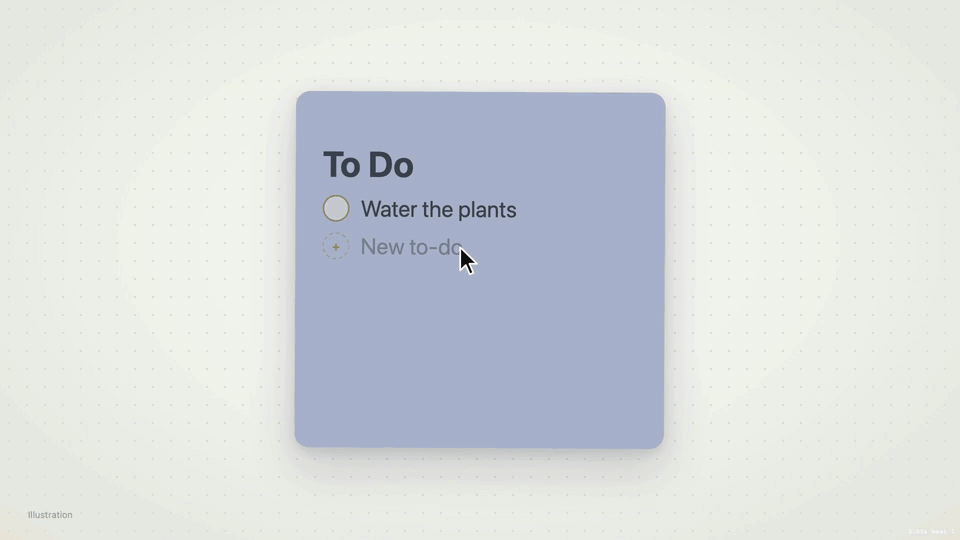

# Sticky ToDo

A sticky-note to-do list for the macOS desktop. It sits behind your windows like a widget, but you can type into it directly.



Includes 14 themes and lets you customize the background, card, decorations, font and colors. You can also use your own background image. The interface is available in English and German (switch under **Settings → Window → Language**).

## Download

**[⬇ Download the latest version (ToDo.zip)](https://github.com/NOX2912/sticky-todo/releases/latest/download/ToDo.zip)**

Unzip it and move **To Do.app** to your Applications folder. Requires macOS 14 or later. All versions are listed on the [releases page](https://github.com/NOX2912/sticky-todo/releases).

The app is not notarized. On first launch, allow it under **System Settings → Privacy & Security → Open Anyway**.

## Build from source

Requires macOS 14+ and Xcode.

```bash
git clone https://github.com/NOX2912/sticky-todo.git
cd sticky-todo
./build.sh install   # builds and copies "To Do.app" to ~/Applications
```

## Updates

`./build.sh release 1.1` publishes a GitHub release. Installed apps pick it up and offer the update in the note.

## Feedback

Found a bug or have an idea? Use **Report a bug / Suggest a feature** in the menu bar icon or the note's context menu, or [open an issue](https://github.com/NOX2912/sticky-todo/issues/new/choose) directly. A GitHub account is required.

## License

[MIT](LICENSE)
